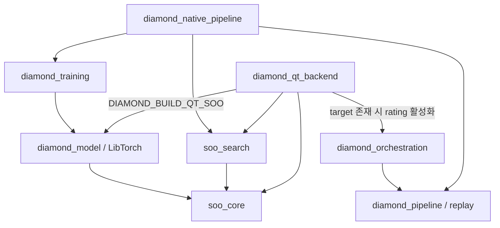

# Engine/Training–Desktop 저장소 분리 분석

작성일: 2026-10-29 (Asia/Seoul). 목적: 학습 실험과 Desktop 앱 개발의 독립 진행.

분석 기준은 HEAD `6ed52bf66783a96606a76c541d97e0ed098e1e24`에 현재 작업 트리 변경을 포함한 상태다.
`native/CMakeLists.txt`, `native/qt/CMakeLists.txt`, 탐색 코드 등에 기존 미커밋 변경이 있으므로 이 문서를 특정 커밋에서 검증된 빌드 결과로 해석하지 않는다.
Serena로 소스와 심볼을 확인했고 Graphify 질의로 모델·rating·runtime 연결을 교차 확인했다. 그래프의 넓은 질의는 출력이 잘리므로 아래 판단은 소스를 기준으로 한다. 이 작업에서는 빌드나 실행 테스트를 수행하지 않았다.

## 권고와 대안

두 저장소를 유지하되 Engine/Training이 공통 엔진의 단일 소유자가 되고 Desktop은 릴리스된 SDK의 정확한 버전을 소비한다.
기존 저장소를 Engine/Training으로 유지하고 Desktop을 새 저장소로 추출하는 방향을 권고한다. 실제 원격 저장소 이름은 아직 확정하지 않는다.
기존 GitHub 모델 배포 주소와 학습 이력을 유지할 수 있고 새 Desktop의 앱 변경이 학습 빌드를 요구하지 않게 된다.

| 방식 | 장점 | 비용 / 판단 |
|---|---|---|
| Engine/Training + Desktop, SDK 버전 고정 | 두 저장소만 관리, 엔진 구현 단일화, 앱 릴리스 독립 | SDK 릴리스 책임 필요. 권고 |
| Core + Training + Desktop | 공통 엔진 소유권이 가장 명확 | 저장소 세 개와 별도 릴리스 운영이 필요해 현재 목적에는 과함 |
| 두 저장소에서 공통 소스 복사 | 최초 이동이 쉬움 | 규칙·인코더·모델 검증이 분기되므로 제외 |

기본 개발 경로는 설치된 SDK 사용이다. 엔진을 함께 수정할 때만 명시적인 로컬 SDK 재빌드와 재설치를 허용한다.
Desktop의 기본 configure에서 Engine 저장소를 clone하거나 `add_subdirectory`로 전체 학습 트리를 포함하지 않는다.
프로세스 분리/RPC, ONNX 전환, 탐색 API 전면 교체, 제3의 저장소 신설은 이번 범위에 포함하지 않는다.

## 현재 의존 관계

이 그림은 직접적인 타깃 링크를 요약한다. Qt가 trainer를 직접 호출한다는 뜻은 아니다.
현재 `DIAMOND_BUILD_LIBTORCH` 블록에서 모델뿐 아니라 trainer, orchestration, CLI 타깃을 함께 정의한다.
`--target diamond_qt` 빌드가 항상 모든 학습 실행 파일을 컴파일하는 것은 아니지만 configure 및 기본 전체 빌드 범위는 결합돼 있다.

## 정리해야 할 경계

| 우선순위 | 현재 근거 | 필요한 변경 |
|---|---|---|
| 필수 | `native/qt/CMakeLists.txt:11–15`, `CMakePresets.json`의 native-qt | 추론을 위한 MODEL 옵션과 TRAINING 옵션 분리. 모델 ON/학습 OFF로 앱과 SDK 빌드 가능하게 함 |
| 필수 | `native/qt/CMakeLists.txt:40–48`, `rating_bridge.cpp`의 rating/rating_store include | `rating.cpp`, `rating_store.cpp`를 독립 `diamond_rating` 타깃으로 분리. Qt의 orchestration 링크 제거 |
| 필수 | `native/CMakeLists.txt:749` 이후 | 현재 export는 soo_core/soo_search만 제공. 모델·artifact·rating과 package config/version, 의존성 재탐색, 설치 include 범위 보완 |
| 필수 | `native_controller.cpp:948`의 loadTopology | `artifacts/soo-spike`, `tests/golden/topology`, 작업 디렉터리 탐색을 앱 기본 동작에서 제거. SDK에서 제공한 topology를 앱 리소스로 포함 |
| 필수 | `tools/build_native_qt.sh:8`, `tools/deploy_native_qt.sh:131–138` | 학습 launcher 호출 제거. 모델과 topology를 SDK/명시적 배포 입력에서 가져오도록 변경 |
| 필수 | `model_catalog.cpp:32`, `277` 이후 | 모델 배포 주소를 앱 소스 저장소와 분리. 기존 Engine GitHub/HF를 배포 원본으로 유지하고 설정 파일로 고정 |
| 필수 | `.github/workflows/ci.yml:84` 이후, `native/qt/CMakeLists.txt:176` 이후 | 현재 Qt CI는 학습/추론 옵션 없이 shell 경로를 테스트. SDK의 실제 Soo/Min 추론 및 rating이 포함된 CI를 추가 |
| 필수 | 루트 CMake/Makefile, `cmake/Verify*.cmake` | 혼합 패키징과 공통 정책 검사를 제품별로 분리. Desktop에 학습 golden 전체가 있어야 한다는 가정을 제거 |
| 함께 정리 | `native/CMakeLists.txt:61`, `141` | json.cpp가 replay와 model에 중복 편입. `diamond_support`로 단일화해 artifact/rating이 replay에 의존하지 않도록 함 |

### Runtime SDK 범위

Engine/Training 안에서 다음 타깃을 SDK로 제공한다. 새 타깃 이름은 제안이며 기존 C++ namespace는 유지한다.

| 타깃 | 소스 / 책임 | 학습 의존성 |
|---|---|---|
| `alphadiamond::soo_core` | board, rules, topology, encoder, min_experts, prior | 없음 |
| `alphadiamond::soo_search` | batcher, evaluator, MCTS2P/3P, profile, search metrics, 현재 selfplay | 없음. selfplay를 별도 분리하는 것은 첫 분리의 선행 조건이 아님 |
| `alphadiamond::diamond_support` (신규) | `native/src/json.cpp`, `diamond_support/json.hpp` | 없음 |
| `alphadiamond::diamond_artifact` (신규) | `deployment_artifact.cpp`, deployment_artifact/model_index 헤더 | core + support. 현재 소스에는 Torch include가 없음 |
| `alphadiamond::diamond_model` | `soo_model.cpp`, `soo_evaluator.cpp`, 모델 공개 헤더 | core + artifact + LibTorch. trainer 불필요 |
| `alphadiamond::diamond_rating` (신규) | `rating.cpp`, `rating_store.cpp`, 기존 rating 헤더 | support. orchestration/replay 불필요 |

`diamond_pipeline`과 orchestration은 필요한 support/rating에 역으로 의존한다. 파일을 모두 재배치하거나 namespace를 바꿀 필요는 없다.
공개 헤더 경로가 `diamond_orchestration/rating.hpp`여도 타깃 의존성이 학습에서 분리되어 있으면 첫 릴리스의 목적을 충족한다.
설치 헤더를 `include/` 전체로 복사하는 현재 규칙은 SDK 공개 헤더 allowlist로 바꾼다. trainer/replay/coordinator API는 SDK에서 제외한다.

현재 `soo/` 공개 헤더에서 `diamond_*` include는 발견되지 않았다. 따라서 코어·탐색 경계를 보존한 점진적 분리가 가능하다.
Qt에 있는 `SooSearchRuntime`은 QString, Qt의 환경 설정과 앱 탐색 결과를 연결하므로 첫 단계에서는 Desktop에 유지한다.
공통 MCTS/모델 알고리즘은 Engine에 남기고 Qt 어댑터까지 SDK로 이동시키지 않는다.

### Rating 기능을 잃지 않는 분리

`RatingBridge::syncPending()`은 라이브러리 링크 외에도 `sync_ratings.sh`, `alphadiamond-rating-sync`, shell을 QProcess로 실행한다.
해당 스크립트는 외부 `hf` CLI를 사용한다. 현재 deploy 스크립트에는 이 조합의 배포가 명시돼 있지 않다.
따라서 라이브러리만 분리하면 온라인 sync가 독립된다고 볼 수 없다.

- 로컬 이벤트 기록, outbox/receipt, protocol-v2 및 identity 의미는 기존대로 유지한다.
- `alphadiamond-rating-sync`는 Engine이 소유하되 training OFF에서도 독립적으로 빌드해 SDK tools 산출물에 포함한다.
- Desktop은 launcher를 소유한다. 온라인 sync는 기존 shell/hf 설치가 있는 명시적 설정에서 실행하고, 미설치/오프라인이면 기존처럼 outbox를 보존한다.
- 일반 앱 설치가 shell/hf 없이도 시작·대국·로컬 기록을 수행하는 것을 필수 조건으로 한다. 온라인 sync의 완전한 네이티브 재작성은 별도 작업이다.

### 모델 계약은 재사용

`deployment_artifact.hpp`, `model_index.hpp`, `deployment_artifact.cpp:295` 이후에 이미 다음 계약이 있다.

- format-v3, soo/min family, architecture/텐서 크기, topology/action-space/encoder 식별자 검증.
- `model_sha256`, `runtime_sha256` 및 runtime-only bundle 검증.
- 학습 checkpoint와 앱용 raw tensor 배포 artifact의 구분.
- encoder legacy-v1과 goals-v2 구분, Soo scalar value와 Min seat별 value 구분.

분리를 위해 format-v4를 만들거나 strict metadata.json에 임의의 필드를 추가하지 않는다.
SDK 릴리스 manifest와 Desktop lock에 호환 계약을 별도로 기록한다. 모델 버전·SDK 버전·앱 버전은 독립적이다.
현행 모델도 그대로 지원하며 encoder/architecture가 바뀌는 실험 모델은 구 SDK를 사용하는 앱에서 안전하게 거절되어야 한다.
동일 `(family, version)`의 다른 digest를 새 모델로 덮어쓰지 않는다.

### SDK 버전과 배포

첫 SDK 버전은 제안값 `0.1.0`, 태그는 `engine-sdk/v0.1.0`이다. Desktop은 정확한 버전과 패키지 SHA-256을 고정한다.
패키지는 OS/CPU/compiler toolset/build configuration/LibTorch version/CPU 또는 CUDA/C++ ABI 식별자를 포함한다.
처음에는 Desktop용 CPU 추론 패키지를 기본으로 하고 CUDA 학습 kit는 별도로 유지한다. 같은 SDK 소스도 다른 ABI의 바이너리로 교체하지 않는다.
현재 루트는 C++26 dialect를 요구한다. SDK 소비자에도 그 조건을 전달/검증하고 이번 분리에서 표준을 낮추지 않는다.
Qt 하한 6.6, QML preview 하한 6.12는 Desktop에 보존한다.

`find_package(AlphaDiamondEngine 0.1.0 EXACT CONFIG REQUIRED)`를 제안한다.
패키지 config는 `find_dependency(Threads)`와 모델 component 선택 시 Torch를 재탐색하고 모든 공개 usage requirement를 제공한다.
SDK를 만든 머신의 source/build/Torch 절대 경로가 export에 남아 있으면 안 된다.
Windows Debug/Release와 MSVC CRT, Linux의 LibTorch ABI를 lock과 configure 검사로 확인한다.
가용하지 않은 플랫폼 바이너리는 같은 태그의 소스에서 별도 SDK를 빌드·설치해 사용한다.

## 파일과 데이터의 소유권

| 자산 | Engine/Training | Desktop |
|---|---|---|
| native/include, native/src, native/tests, benchmarks | Qt 외 엔진·학습·release 코드와 normative fixture 원본 | SDK 공개 헤더/라이브러리를 소비 |
| native/qt 전체 | 추출 완료 후 제거 | C++/QML/assets/tests를 `app/`으로 이동 |
| tools | native_training, checkpoint push, 실험 실행/분석 | Qt build/deploy/run/preview 및 rating sync launcher |
| configs/alphazero, az-bench, acceptance-baseline | 유지 | 이전하지 않음 |
| tests/golden, native/tests/data/encoder-v2 | 계약 corpus 원본과 학습 parity 데이터 유지 | SDK에서 topology와 최소 runtime fixture만 공급받음 |
| models/ | 기존 배포 원본/색인 소유. 학습 checkpoint와 구별 | 명시적으로 선택한 배포 bundle만 패키징 |
| TrainAlphaDiamond, runtime/runs, artifacts | 소스 관리 여부와 관계없이 학습 데이터 위치 유지 | 복사하지 않음 |
| docs | 규칙/모델 계약/학습/실험 기록 | 앱 사용법/UI/패키징/개발 문서 |
| .github, CMakePresets, Makefile, AGENTS | 각각의 제품 범위로 재작성 | 각각의 제품 범위로 재작성 |
| graphify-out, .serena | 저장소별 새 인덱스 생성 | 부모 저장소 그래프를 그대로 복사하지 않음 |

`TrainAlphaDiamond/`는 이미 별도 코드베이스가 아니라 HF bucket의 로컬 동기화 루트다.
이름만 보고 저장소로 추출하지 않는다. ignored 데이터, untracked 모델 payload, 로컬 빌드와 비밀 설정은 Git 추출에 포함하지 않는다.
현재 작업 트리에 필요한 미추적 소스가 있을 수 있으므로 추출 직전 tracked/ignored 분류를 검토한다.
앱의 기존 사용자 데이터 경로·조직명·앱 이름을 보존하여 모델 캐시, 저장 대국, rating installation ID/outbox가 이어지게 한다.

## 독립 개발의 완료 조건

1. Desktop만 checkout하고 고정 SDK/모델 fixture를 받아 configure·build·test·package할 수 있다.
2. Engine/Training에 Qt가 없어도 core/model/학습 및 checkpoint resume/export가 동작한다.
3. Desktop의 타깃 그래프에 trainer, replay, orchestration, promotion이 없다.
4. SDK 원본 checkout/build 경로를 숨기고 설치 prefix를 옮겨도 Desktop을 빌드·실행할 수 있다.
5. 모델 없이 앱을 시작하고 대국/보드 표시가 가능하며 Soo/Min 배포 모델을 넣으면 실제 CPU 추론이 동작한다.
6. 학습 실험 커밋만 바꿔도 Desktop lock은 바뀌지 않는다. SDK 업그레이드는 별도 앱 변경으로 검증한다.
7. 두 저장소의 CI·패키징·graphify가 각자의 루트만 전제로 동작한다.

상세 작업 순서와 검증은 [분리 실행 계획](../superpowers/plans/2026-10-29-repository-split.md)을 따른다.

## 참고

- 소스: `native/CMakeLists.txt`, `native/qt/CMakeLists.txt`, `native/qt/{native_controller,soo_search_runtime,model_catalog,rating_bridge}.cpp`.
- 기존 계약: `docs/architecture/model_artifact_v3.md`, `tests/golden/MANIFEST.json`.
- 설치 패키지 구성은 Context7로 확인한 [CMake 공식 packages 문서](https://github.com/Kitware/CMake/blob/master/Help/manual/cmake-packages.7.rst) 및 [importing/exporting 가이드](https://github.com/Kitware/CMake/blob/master/Help/guide/importing-exporting/index.rst)를 기준으로 한다.
- 과거 문서에는 Python exporter/테스트를 가리키는 오래된 설명이 남아 있다. 실행 경로는 현재 C++ 소스를 기준으로 판단하며 분리 시 해당 문서도 정리한다.
